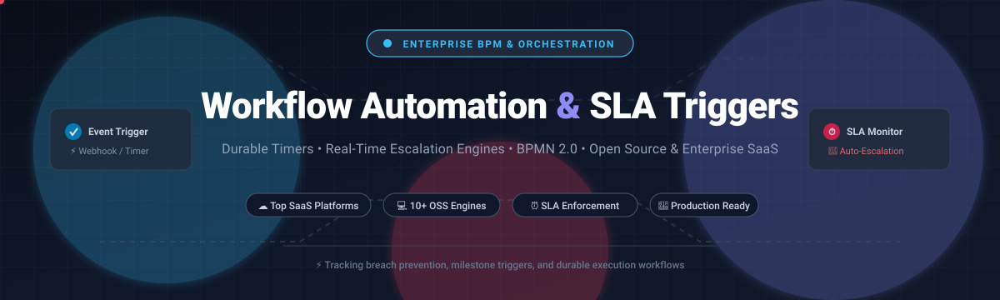

# Awesome Workflow Automation & SLA Triggers ⚡

<p align="center">
  
</p>

<p align="center">
  <a href="https://github.com/ishandutta2007/Awesome-Awesome-Awesome"></a>
  <a href="https://discord.gg/jc4xtF58Ve"></a>
  <a href="https://github.com/ishandutta2007/Awesome-Workflow-Automation-Sla-Triggers/stargazers"></a>
  <a href="https://github.com/ishandutta2007/Awesome-Workflow-Automation-Sla-Triggers/network/members"></a>
  <a href="https://github.com/ishandutta2007/Awesome-Awesome-Awesome"></a>
  <a href="https://creativecommons.org/publicdomain/zero/1.0/"></a>
  <a href="https://github.com/ishandutta2007"></a>
</p>

> 🌟 **A curated directory of top Workflow Automation, Business Process Management (BPM), and SLA Trigger platforms** — highlighting enterprise commercial SaaS systems and powerful open-source workflow orchestration engines for mission-critical deadline enforcement, time-based triggers, and automated escalation workflows.

---

## 🧭 Table of Contents
- [🌐 Sector Overview & Market Dynamics](#-sector-overview--market-dynamics)
- [🟦 SaaS / Hosted Platforms](#-saas--hosted-platforms)
- [🟩 Open-Source Software](#-open-source-software)
- [📊 Feature Comparison Matrix](#-feature-comparison-matrix)
- [💡 Architectural Patterns for SLA Enforcement](#-architectural-patterns-for-sla-enforcement)
- [🤝 Contributing](#-contributing)
- [💖 Support](#-support)
- [📈 Star History](#-star-history)
- [📄 License](#-license)

---

## 🌐 Sector Overview & Market Dynamics

The global workflow automation and process orchestration market is valued at approximately **$22.3B – $25.1B in 2025** and is projected to surpass **$65B+ by the early 2030s**, expanding at a robust Compound Annual Growth Rate (CAGR) between **11% and 21%** driven by enterprise hyperautomation and AI agent orchestration. 

The market exhibits **moderate consolidation at the top**—dominated by hyperscalers, CRM/ITSM ecosystems, and enterprise automation giants (such as Freshworks, ServiceNow, Zapier, Workato, and Appian)—alongside **intense fragmentation across specialized and open-source domains**, where niche BPM engines, event-driven orchestrators, and developer-centric code frameworks compete aggressively for developer adoption and customized departmental workflows.

---

## 🟦 SaaS / Hosted Platforms

Below is a breakdown of prominent commercial SaaS platforms offering workflow automation, timer-based event handling, and SLA breach escalation. The table is ranked in descending order by **Company Size (Revenue / Valuation)**:

| Platform | Company Size (Revenue / Valuation) | Pricing (Starting Tier) | Free Tier Limits / Free Trial | Primary Workflow & SLA Capabilities |
| :--- | :--- | :--- | :--- | :--- |
| **[Freshworks](https://www.freshworks.com)** 💼 | **~$600M+ ARR / $4.5B Market Cap** *(NASDAQ: FRSH)* | **$15 / agent / month** *(Growth tier)* | **Free forever plan** for up to 10 agents on Freshdesk; 14-day full-featured free trial for Freshservice/Freshsales | Full ITSM & CRM workflow suite with multi-tier ticket SLA management, milestone notifications, automated priority assignment, and time-based escalation policies. |
| **[Workato](https://www.workato.com)** 🏢 | **~$150M+ ARR / $5.7B Valuation** *(Private)* | **$75 / month** *(Base self-service; enterprise plans from $20,000/yr)* | **Free evaluation account** with one-time 50,000 credits grant; 30-day enterprise sandbox trial | Enterprise iPaaS offering recipes, multi-step triggers, time-based delayed execution, condition trees, and mission-critical enterprise SLA escalations across 1,000+ connectors. |
| **[Zapier](https://www.zapier.com)** ⚡ | **~$310M+ ARR / $5.0B Valuation** *(Private)* | **$19.99 / month** *(Professional tier, billed annually)* | **Free forever plan** limited to 100 tasks/month, 2-step Zaps (1 trigger + 1 action), and 15-minute update polling; 14-day Pro trial | Connects 7,000+ apps with webhook triggers, scheduled cron events, delay filters, and automated escalation notifications across ticketing and messaging platforms. |
| **[Nintex](https://www.nintex.com)** 📜 | **~$250M ARR / $2.0B Valuation** *(Acquired by TPG)* | **$625 / month** *(Standard workflow entry tier)* | **30-day free trial** with full access to forms, workflow design, and document generation; no perpetual free tier | Enterprise BPM platform specializing in digital forms, document automation, and multi-tier approval chains with automated deadline reminders and SLA escalation timers. |
| **[Appian](https://www.appian.com)** 🏛️ | **~$550M+ ARR / $1.2B Market Cap** *(NASDAQ: APPN)* | **$75 / user / month** *(Standard tier entry)* | **Free perpetual Community Edition** cloud sandbox for learning and development; 30-day guided enterprise trial | Low-code enterprise application and BPM suite featuring automated SLA tracking, milestone management, escalation routing, and complete compliance audit trails. |
| **[Make](https://www.make.com)** 🎨 | **~$50M+ ARR** *(Subsidiary of Celonis, $13B Valuation)* | **$9 / month** *(Core tier with 10,000 operations, billed annually)* | **Free forever plan** with 1,000 operations/month, 2 active scenarios, and 15-minute minimum schedule intervals | Visual drag-and-drop workflow canvas with granular scheduling, router branching, error execution directives, and webhook-triggered deadline monitors. |
| **[Camunda (SaaS)](https://www.camunda.com)** 🔄 | **~$80M+ ARR / $500M+ Valuation** *(Venture-backed)* | **$80,000 / year** *(Enterprise SaaS cluster entry estimate)* | **Free Developer Edition** with unlimited BPMN/DMN modeling for up to 5 seats, plus a 30-day free trial of live cloud execution clusters | Cloud BPMN 2.0 orchestration engine with interrupting and non-interrupting boundary timers for resilient SLA breach warnings and automated rerouting. |
| **[ProcessMaker](https://www.processmaker.com)** ⏱️ | **~$25M+ ARR / $100M+ Valuation** *(Private)* | **$1,495 / year** *(Base platform entry tier)* | **14-day free trial** with unlimited access to the workflow designer and sample cases; no perpetual free production tier | Low-code BPM platform providing automated case routing, interactive forms, custom SLA timers, and automated managerial escalation triggers. |
| **[Kissflow](https://www.kissflow.com)** 👥 | **~$20M ARR / $80M Valuation** *(Private)* | **$1,500 / month** *(Basic corporate package including base user block)* | **14-day assisted proof-of-concept trial** upon consultation; no public self-service perpetual free tier | No-code digital workplace and business process engine with deadline enforcers, approval milestones, SLA tracking dashboards, and escalation alerts. |
| **[Pipefy](https://www.pipefy.com)** 📋 | **~$15M ARR / $70M Valuation** *(Private)* | **$33 / user / month** *(Business tier)* | **Free forever Starter plan** for up to 10 users with basic workflow pipes and limited automation triggers | Kanban-centric process automation with field-level conditionals, public intake forms, SLA deadline timers, and automated reminder notifications. |

---

## 🟩 Open-Source Software

Self-hosted, community-driven workflow engines, durable execution platforms, and dedicated SLA trigger tools. 

The table below is sorted in descending order by **GitHub Stars_Count**:

| Project | GitHub_Stars | Primary Stack | License | Core SLA & Timer Mechanism | Best For |
| :--- | :---: | :--- | :--- | :--- | :--- |
| **[n8n](https://github.com/n8n-io/n8n)** 🪢 | [](https://github.com/n8n-io/n8n/stargazers) | TypeScript / Node.js | Fair-code (Sustainable Use) | Cron node, interval triggers, Wait node (resume on date/webhook), and error workflow escalations. | Self-hosted integration workflows & automated webhook/time-based escalations. |
| **[Huginn](https://github.com/huginn/huginn)** 🦅 | [](https://github.com/huginn/huginn/stargazers) | Ruby | MIT | Event-driven agents, scheduler triggers, delayed notification agents, and threshold breach triggers. | Building custom event monitors, alerting pipelines, and rule-based SLA watchdogs. |
| **[Apache Airflow](https://github.com/apache/airflow)** 🌪️ | [](https://github.com/apache/airflow/stargazers) | Python | Apache 2.0 | Native SLA miss callbacks (`sla_miss_callback`), task sensors, timeouts, and cron scheduling DAGs. | Batch data pipelines and enterprise orchestrations with explicit task/DAG SLA monitoring. |
| **[Netflix Conductor](https://github.com/conductor-oss/conductor)** 🚦 | [](https://github.com/conductor-oss/conductor/stargazers) | Java | Apache 2.0 | Microservice orchestration, task timeouts, queue retries, and scheduled polling tasks. | Distributed microservice orchestration with strict task timeout and failure escalation paths. |
| **[Activepieces](https://github.com/activepieces/activepieces)** 🧩 | [](https://github.com/activepieces/activepieces/stargazers) | TypeScript | MIT | Visual automation builder, scheduled polling triggers, delayed execution steps, and branch routers. | Lightweight open-source Zapier alternative for self-hosted trigger-action automations. |
| **[Temporal](https://github.com/temporalio/temporal)** ⏳ | [](https://github.com/temporalio/temporal/stargazers) | Go / Multi-SDK | MIT | Durable execution timers, updatable deadline timers via signals, and deterministic timeout handlers. | Code-first mission-critical workflows requiring dynamically extendable SLA deadlines and grace periods. |
| **[Automatisch](https://github.com/automatisch/automatisch)** 🤖 | [](https://github.com/automatisch/automatisch/stargazers) | JavaScript | AGPL-3.0 | Time-based polling triggers, webhook listeners, conditional execution rules, and external action dispatches. | On-premise workflow automation without vendor lock-in or GDPR/privacy data leakage. |
| **[Flowable](https://github.com/flowable/flowable-engine)** 🌊 | [](https://github.com/flowable/flowable-engine/stargazers) | Java | Apache 2.0 | Async executor-backed BPMN timer events (`timeDate`, `timeDuration`, `timeCycle`), non-interrupting reminders, interrupting escalation boundaries. | High-throughput enterprise BPMN/CMMN process automation with strict SLA timers and dead-letter compensation. |
| **[Camunda Platform 7](https://github.com/camunda/camunda-bpm-platform)** ⚙️ | [](https://github.com/camunda/camunda-bpm-platform/stargazers) | Java | Apache 2.0 | Job executor with BPMN boundary timer events, intermediate timer events, and incident escalation handlers. | Robust open-source BPMN 2.0 workflow execution deployed within standard JVM / Spring Boot ecosystems. |
| **[Apache jBPM](https://github.com/kiegroup/jbpm)** ☕ | [](https://github.com/kiegroup/jbpm/stargazers) | Java | Apache 2.0 | Human task deadline timers, notifications, pluggable lifecycles, and Drools business rule integration. | Java-centric enterprise architectures requiring Apache-governed BPMN modeling and rule-driven escalation. |
| **[AlgaPSA](https://github.com/Nine-Minds/alga-psa)** 🛠️ | [](https://github.com/Nine-Minds/alga-psa/stargazers) | TypeScript / PostgreSQL | AGPL-3.0 | Dedicated SLA milestone tracker (first response/resolution), business hours + holiday calendars, 3-level escalation engine. | MSPs and IT ticketing teams needing turnkey ITIL-compliant SLA enforcement and pause/resume logic. |
| **[FreeITSM](https://github.com/edmozley/freeitsm)** 🎫 | [](https://github.com/edmozley/freeitsm/stargazers) | PHP / MySQL | Open Source | Deduplicated `workflowEmitOnce()` database ledger trigger, cron evaluation, and priority-shift re-arming. | Lightweight IT service management requiring reliable time-based trigger execution without heavyweight engines. |

---

## 📊 Feature Comparison Matrix

| Platform / Tool | Type | License | Timer Reliability | Dynamic SLA Extensions | Business Hours & Calendars | Self-Hosted Option | Best Fit |
| :--- | :--- | :--- | :--- | :---: | :---: | :---: | :--- |
| **Freshworks** | SaaS Suite | Commercial | 99.9% Cloud SLA | ⚠️ Policy updates | ✅ Native | ❌ | Freshdesk / Freshservice teams |
| **Zapier** | SaaS iPaaS | Commercial | Cloud Managed | ❌ Fixed delay | ❌ Needs formulas | ❌ | Fast no-code integrations |
| **Make** | SaaS iPaaS | Commercial | Cloud Managed | ⚠️ Variable math | ❌ Needs formulas | ❌ | Visual multi-step branching |
| **Workato** | Enterprise SaaS | Commercial | Cloud Managed | ✅ Dynamic recipes | ⚠️ Custom lookup | ❌ | Enterprise systems orchestration |
| **Nintex** | Enterprise SaaS | Commercial | Cloud Managed | ⚠️ Configuration | ✅ Supported | ❌ | SharePoint & Office 365 processes |
| **Appian** | Low-Code BPM | Commercial | Cloud / On-Prem | ✅ Full control | ✅ Native | ⚠️ Custom license | Regulated enterprise compliance |
| **n8n** | OSS / Self-Hosted | Sustainable Use | High (Queue / Redis) | ⚠️ Node logic | ⚠️ Custom code | ✅ | General self-hosted automation |
| **Temporal** | Workflow-as-Code | MIT | High (Durable replay) | ✅ Full code signals | ✅ Via code libraries | ✅ | Engineering teams building complex stateful SLAs |
| **Flowable** | BPMN 2.0 Engine | Apache 2.0 | High (Async Executor) | ✅ Boundary events | ⚠️ Via custom calendar | ✅ | Java enterprise application teams |
| **Apache Airflow** | Data Orchestrator | Apache 2.0 | High (Scheduler) | ⚠️ DAG SLA callbacks | ⚠️ Custom schedules | ✅ | Scheduled data pipelines & batch SLAs |
| **AlgaPSA** | ITSM / PSA | AGPL-3.0 | High (PgBoss / Temporal)| ✅ Milestone shifts | ✅ Native ITIL engine | ✅ | MSPs and helpdesk operations |
| **FreeITSM** | ITSM Platform | Open Source | Medium (Cron + DB) | ✅ Fingerprint re-arm | ⚠️ Standard tables | ✅ | Lightweight ticketing setups |

---

## 💡 Architectural Patterns for SLA Enforcement

When architecting time-triggered workflows and SLA escalation rules, three primary patterns dominate modern engineering:

### 1. The Durable Replayable Timer Pattern *(e.g., Temporal)* ⏳
```
+-----------------------------------------------------------+
| Workflow Execution Thread                                 |
|                                                           |
|  [Task Created] ---> [Start Durable Timer (e.g. 4 Hours)]  |
|                             |                             |
|       +---------------------+---------------------+       |
|       |                                           |       |
|  Signal: "Approved / Resolved"         Timer Expires (4h) |
|       |                                           |       |
|  [Cancel Timer & Proceed]              [Trigger Escalation]
+-----------------------------------------------------------+
```
* **Mechanism:** Rather than relying on fragile polling crons, timers are compiled as deterministic workflow code backed by an append-only event log.
* **Benefit:** If an SLA extension is granted (e.g., waiting for customer feedback), a signal simply resets or extends the timer duration without risking drift.

### 2. The BPMN 2.0 Boundary Timer Pattern *(e.g., Flowable, Camunda, jBPM)* 🔄
* **Non-Interrupting Boundary Timer:** Fires an alert (e.g., at 75% or 90% SLA elapsed duration) to warn agents without canceling the underlying human assignment.
* **Interrupting Boundary Timer:** Abruptly cancels the pending task when 100% time expires, reassigning it to tier-2 support or a department lead.

### 3. The Idempotent Ledger / Fingerprint Pattern *(e.g., FreeITSM, AlgaPSA)* 🗄️
* **Problem:** Time-based events have no write-path moment to trigger off—time passes continuously while records sit idle.
* **Solution:** A background cron evaluates pending milestone deadlines and passes events through an idempotent emit ledger with a unique composite key: `(Entity_ID, Target_State, Deadline_Timestamp)`. Overlapping cron jobs cannot trigger double notifications, and changes to priority cleanly trigger re-arming.

---

## 🤝 Contributing

Contributions are warmly welcomed! To suggest an open-source workflow automation or SLA trigger platform:
1. 🍴 Fork the repository.
2. 🌿 Create your feature branch (`git checkout -b feature/add-new-tool`).
3. 📝 Add the tool to the appropriate table in alphabetical or star-sorted order with URL, primary stack, and standout capabilities.
4. 🚀 Open a well-documented Pull Request.

---

## 💖 Support

If you found this curated list valuable for your projects or research, please consider supporting the project:

- ⭐ **Star** this repository to help others discover it.
- 🍴 **Fork** and share it with your engineering and DevOps colleagues.
- 📢 **Share** your feedback, use cases, or suggested additions via GitHub issues or discussions.
- ☕ **Buy a coffee & sponsor**: Support continuous maintenance via the [GitHub Sponsor Dashboard](https://github.com/sponsors/ishandutta2007).

---

## 📈 Star History

[](https://star-history.dera.page/#ishandutta2007/Awesome-Workflow-Automation-Sla-Triggers&type=date&legend=top-left)

---

## 📄 License

This collection is released under the [Creative Commons Zero v1.0 Universal](https://creativecommons.org/publicdomain/zero/1.0/) (CC0 1.0) Public Domain Dedication. Listed third-party software packages and brand trademarks belong to their respective owners.

<p align="center">
  ⭐ <b>Found this resource helpful? Give it a star to support the community!</b> ⭐
</p>
